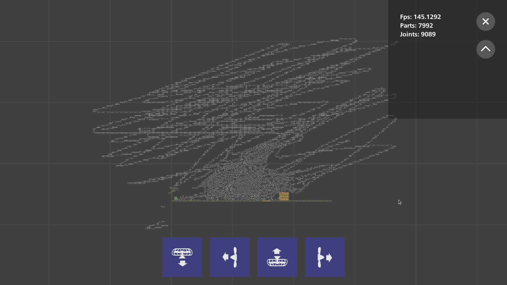

# BpsimF

**Bad piggies fan-made game--BPLE's simulator F version**

> [!WARNING]
> **本项目近乎全部由 AI 辅助开发，测试而来。**
>
> 本项目由反编译的BPSIM 2022.2.7 工程二次开发而来，参考项目包含 besiege，bple，bpir，bpss，bprc等。
> 然后 AI 就自己源源不断的在缝合代码石块了，测试也不够完全。

> 本仓库与 Rovio Entertainment 及 Bad Piggies **无任何关联**，亦未获其认可。
> "捣蛋猪" / "BP" 等名称仅作技术识别之用，仓库所有者不持有相关商标；
> 产物 DLL/CS 文件名沿用原版名称 仅为交流方便。

## 这是什么

BpsimF 是《Bad Piggies》（捣蛋猪）的粉丝向模拟器，目标是在 Unity 里还原 BPLE的建造体验：无网格自由拼装、按章节组织的关卡、以及“部件堆成山也不卡”的物理沙盒。

和“一个部件一个 GameObject”的常规做法不同，这里的部件是 ECS 实体，渲染走自绘的 BatchRendererGroup + DOTS Instancing 管线，物理走 Unity.Physics + 打过补丁的 Havok 运行时。因此一辆两万部件的载具仍然能以可交互的帧率跑起来（见[性能](#性能)）。

当前版本 `0.0.12`，状态是**能玩的开发中版本**：建造、选关、模拟、模组、Windows / Android 出包链路都已打通，玩法细节仍在对照 BPLE / BPIR / BPSS 逐步补齐。



*早期版本截图：7992 parts / 9089 joints。*

## 技术栈

| 层面 | 方案 |
|------|------|
| 引擎 | Unity `2022.2.23f1c1`（Unity 中国版） |
| 架构 | DOTS / ECS：Entities `1.0.0-pre.44`、Collections `2.1.0-pre.11`、Burst `1.8.4`、Mathematics `1.2.6` |
| 物理 | Unity.Physics `1.0.0-pre.44` + Havok.Physics（本地补丁运行时） |
| 渲染 | URP `14.0.7`；部件用 BatchRendererGroup 批量实例化；UI 用 uGUI + TextMeshPro |
| 输入 | Input System `1.7.0`（键鼠 + 触屏） |
| 模组面板 | Vuplex WebView（HTML/CSS/JS 面板） |
| 序列化 / 异步 | Newtonsoft.Json / UniTask |
| 模组 | 内置 Mod 体系（Besiege 式 `Mod.xml` 清单 + GUID + 入口钩子），**不依赖 BepInEx** |

`Packages/` 下是**内嵌**（`file:` / `source: embedded`）的 DOTS、URP、Burst 包，以及一个只负责定义 `HAVOK_PHYSICS_EXISTS` 的 Havok 占位包；真正的 Havok 运行时是 `Assets/Plugins/` 里的 `Havok.Physics.dll` 与 `x86_64/HavokNative.dll`。

## 功能与完成度

| 模块 | 状态 | 说明 |
|------|------|------|
| 无网格建造 | ✅ | 放置、拖动、旋转、缩放、删除、撤销；网格吸附可关闭 |
| 图层 | ✅ | 1–16 层，逐层网格图，跨层重叠，2..N 层焊到第 1 层 |
| QuickBuild | ✅ | 点按旋转、长按拖动、自动对齐（`InteractionSettings.QuickBuild`，默认开） |
| 部件 | ✅ 49 个 PartType | 框 / 梁 / 轮 / 马达 / 弹簧 / TNT / 气球 / 螺旋桨 / 喷气引擎 / 吸盘枪 / 猪 / 皮肤件等 |
| 关卡 | ✅ 274 关 | 按 BPLE 索引加载；地形由 2D 三角挤出为有厚度棱柱；自动恢复上次关卡与存档 |
| 选关 | ✅ | BPLE 风格方形数字格，8 列一章 |
| 物理 | ✅ | Unity.Physics + Havok；可选 MegaStructure 整车刚体化 |
| 模组 | ✅ | `Mod.xml` 清单、网页面板、托管插件、程序集静态扫描、GUID 存档绑定、工坊安装 |
| Android | ✅ | Mono2x + ARMv7 + GLES3，minSdk 22，可出 APK |
| 玩法目标 / 关卡机关 | 🚧 | sandbox、race、剧情章节仍在补 |
| 联机 | ❌ | 无 |

## 性能

开发机实测（详见 [`BPSIM_MEGA_STRUCTURE.md`](BPSIM_MEGA_STRUCTURE.md)）：

| 测试载具 | 部件数 | 优化前 | 优化后 | 备注 |
|----------|-------:|-------:|-------:|------|
| 天使座 | 20,405 | 238.4 ms/step | **33.4 ms/step** | 180,832 个约束；StartSimulation 898 → 483 ms |
| 天使座（自旋 ω=32） | 20,405 | 358.1 ms/step | **31.8 ms/step** | AABB 膨胀导致的互撞修复后 |
| 不败荣光 | 1,648 | 6.30 ms/step | **3.80 ms/step** | StartSimulation 86.0 → 65.8 ms |

关键手段：

- **MegaStructure**：把整车合成一个刚体 + 复合碰撞体，部件只做视觉挂接，受击速度超过 `MegaStructureBreakSpeed` 时脱开；部件之间不再两两建约束（关节总数从 180,832 降到整车一份）。
- **JobChunk 镜像 / 驱动**、按载具分类位裁剪射线（一辆车 1161 个轮子时尤其明显）。
- 高速自旋时 AABB 膨胀引发的同车互撞、时间倍速低倍率抖动、建造行为层平方级开销等专项修复。

已知边界：两万部件时复合 BVH 构建约 211 ms；未做物理岛拆分；`MegaPartDamage` 尚未启用；MegaStructure 下没有逐部件刚体。

复测入口：`perf/` 下有 `run.sh` / `build.sh` / `launch_editor.py`，通过编辑器 HTTP 桥调用 `Bpsim.QA.SpinPerfProbe.Run`，并解析 `Editor.log` 输出；`天使座`、`不败荣光`、`bpsim1号机` 是仓库根目录的测试载具 CSV。

## 目录结构

```
Assets/
├─ Scenes/MainScene.unity          唯一构建入口（Game.unity 是备份，BrandSplash 仅编辑器预览）
├─ Scripts/Assembly-CSharp/Bpsim/
│  ├─ Parts/                       部件定义、模拟系统、皮肤（Simulation / Gameplay / Skin）
│  ├─ UI/                          建造 HUD、工具栏、图层面板、属性面板、选关…
│  ├─ Rendering/                   BatchRendererGroup 部件渲染、Sprite / 材质
│  ├─ Levels/                      关卡索引、导入、会话
│  ├─ Mods/ + Modding/             模组加载（Mod.xml / 扫描器 / 入口钩子）、面板、工坊
│  ├─ QA/                          运行时探针与自测
│  ├─ Templates/ Physics/ Background/ Collections/ Serialization/…
├─ Editor/Bpsim/                   Windows / Android 构建脚本
├─ Editor/DshBridge/               编辑器 HTTP 桥（自动化 / 测试用，默认 127.0.0.1:8791）
├─ Plugins/                        Havok、DOTS 玩家程序集、第三方 DLL
├─ StreamingAssets/                关卡 / Mod / WebPanel —— 被 .gitignore 排除，不随仓库分发
├─ Vuplex/                         WebView
└─ Resources/ Texture2D/ Material/ Shader/…
Packages/                          内嵌的 DOTS / URP / Burst 包与 Havok 占位包
Tools/                             二进制补丁、品牌烘焙、unity-batch.bat
Mods/FrameShapes/                  变形框插件源码（旧 BepInEx 工程，已不再被构建步骤部署）
perf/                              性能测试脚本、载具 CSV、采样日志
Brand/                             品牌 wordmark / 图标 / 启动页素材
README-assets/                     README 截图
*.md                               各专题开发记录（见「文档地图」）
```

`Assets/Scripts/Assembly-CSharp/Bpsim/` 下约有 350 个 `.cs` 文件：Parts 149、UI 52、QA 22、Templates 19、Rendering 15、Mods 13、Levels 8……

## 快速开始

### 环境

- Unity **2022.2.23f1c1**（Unity 中国版，与 `ProjectSettings/ProjectVersion.txt` 一致）；其他版本未验证。
- Windows 10/11 x64。Android 出包另需 Unity 的 Android 模块与 JDK / SDK / NDK。
- 仓库里 `*.dll`、`*.so`、`*.png` 等走 **Git LFS**：先 `git lfs install` 再 clone，否则拿到的是 LFS 指针文件。
- 首次打开时 Unity 会解析 `Packages/` 里的内嵌包，不需要联网拉 registry 版本。

### 运行

1. 用 Unity Hub 打开仓库根目录（不是 `Assets/`）。
2. 打开 `Assets/Scenes/MainScene.unity`，按 Play。构建时也只会打这一个场景。
3. 键鼠与触屏输入由 `Assets/Scripts/BpsimCompat/BpsimInputModule.cs` 统一适配（工程用的是预编译 `UnityEngine.UI.dll`，不能直接挂 Input System 自带的 UI 模块）。

> **数据准备（重要）**
>
> `Assets/StreamingAssets/` 整个目录被 `.gitignore` 排除（`/[Aa]ssets/StreamingAssets/`），因此 GitHub 上的仓库**只含源码**，不包含 274 关的关卡数据、内置 Mod 和 WebPanel。直接 clone 后主场景仍可打开，但 Console 会提示 `[BpsimLevels] StreamingAssets/BpsimLevels is missing; the level importer stays disabled. Run Tools/BPSim/export_levels.py --write.`，关卡导入器停用、选关为空（这条提示里引用的导出脚本也不在仓库里，见「已知限制」）。
>
> 需要自行准备 `Assets/StreamingAssets/BpsimLevels/`（`index.json`、`levels/`、`contraptions/`、`textures/`、`prefabs.json`）与 `Assets/StreamingAssets/Mods/`、`Assets/StreamingAssets/WebPanels/`；`LevelBootstrap` 与 `LevelCatalog` 的字段注释就是目录格式说明。

### 构建（Windows）

`Assets/Editor/Bpsim/WindowsPlayerBuild.cs` 没有菜单项，只提供批处理 / 桥调用入口：

```bat
set UNITY_EXE=C:\Program Files\Unity\Hub\Editor\2022.2.23f1c1\Editor\Unity.exe
Tools\unity-batch.bat -executeMethod Bpsim.EditorTools.WindowsPlayerBuild.BuildDefault
```

默认输出 `Builds/HavokTest/bpsim.exe`，可加 `-outDir <目录>` 指定位置。`Tools/unity-batch.bat` 会先清掉环境里大小写重复的代理变量（`NO_PROXY` / `no_proxy` 同时存在会让 Bee 以 `BuildProgram exited with code -532462766` 失败），日志写到 `Logs/unity-batch.log`。

编辑器内也可以走 DshBridge（默认 `http://127.0.0.1:8791/api`，打开工程即自启；`DSH_BRIDGE_PORT` 可覆盖端口）：

```json
{"method":"invoke_static","params":{"type":"Bpsim.EditorTools.WindowsPlayerBuild","method":"Build","args":["Builds/HavokTest"]}}
```

### 构建（Android）

菜单 `Tools/BPSim/Android/Apply Android Settings` 与 `Tools/BPSim/Android/Build APK`，或批处理：

```bat
Tools\unity-batch.bat -executeMethod Bpsim.EditorTools.AndroidBuild.Build
```

输出 `Builds/Android/bpsimF_android.apk`（约 82 MB）。脚本会强制 **GLES3（不启用 Vulkan）**、**ARMv7**、**Mono2x**、`minSdk 22`、普通 APK（非 AAB）；同时剔除 URP 后处理变体，避免一次编译 9 万多个 shader variant。

### 打开工程后可能需要的补丁

仓库里提交的二进制**已经处于打过补丁的状态**；只有在你更新 Unity 包、替换 DLL 或重新导入原始包之后才需要重跑。脚本都是幂等的，可反复执行：

| 脚本 | 作用 |
|------|------|
| `Tools/PatchHavokNative.py` | 补 `HavokNative.dll` 的两处校验（`HP_CheckCompatibility` 直接返回 1，`UnityPluginLoad` 跳过 vtable 检查） |
| `Tools/PatchHavokNativeAndroid.py` | 对 Android `libhavoknative.so` 做同样的补丁（长度不变） |
| `Tools/PatchUrpCoreUtils.py` | 把 URP `CoreUtils::Destroy` 改成编辑模式下走 `DestroyImmediate`（`--verify-only` / `--restore`） |
| `Tools/PatchBurstILPPWarning.py` | 在 `BurstCompiler.cs` 标记 “BPSIM PATCH”，屏蔽预编译第三方插件的 “not a known Burst entry point” 报错 |

`Assets/Editor/BpsimEditorBootstrap.cs` 在编辑器加载时关闭 `JobsUtility.JobDebuggerEnabled`：`Assets/Plugins/` 里的 DOTS / Entities / Physics / Havok 程序集来自 release 播放器构建，容器类型没有内嵌 `AtomicSafetyHandle`，开启调试器反而会报 “uses the [NativeContainer] but has no AtomicSafetyHandle embedded”。

## 模组开发

本项目的 Mod 体系**不依赖 BepInEx**（旧的 BepInEx 通道已移除，见 [`BEPINEX_MODDING.md`](BEPINEX_MODDING.md)）。一个 Mod 就是 `persistentDataPath/Mods/<任意目录>/`（Windows 上是 `%USERPROFILE%\AppData\LocalLow\bprc\bpsimF\Mods\`）下的一个目录，放 `Mod.xml`，再按类型附带 `panel.html/css/js` 和/或托管 DLL。

- 清单：`Mod.xml`（旧 `manifest.json` 仍兼容），带 `<ID>` GUID —— 存档只认 GUID，改文件夹名不会让存档失效。
- 纯内容包：只声明 `<Resources><Panel …/></Resources>`，Vuplex 加载，可拖动。
- 代码包：`<EntryPoint type="…" />` + `<Assemblies><Assembly path="…" /></Assemblies>`，入口类继承 `Bpsim.Modding.ModEntryPoint`；不写 `<Assemblies>` 而把 `.cs` 放进 `Code/` 时，宿主会运行时编译（CodeDom）。
- 加部件：`ModParts.TryAddVariant(PartType.MetalFrame, 12, 9001, "直角三角框", out error)` —— 克隆基部件换索引，选择器的变体列表里就会出现。
- 加载前会跑程序集静态扫描：引用 `Steamworks` / `Mono.Cecil` / Roslyn、用 `PInvoke`、碰 `System.Reflection.Emit` 之类的直接拒绝。

游戏内按 **F10**（或设置里的“打开 Mod 管理器”）打开列表。内置样板有三个：`example-addon/`（`Mod.xml` 纯面板）、`netease-music/`（旧 `manifest.json`，验证兼容）、`bpir-frame-shapes/`（**源码 Mod**，注册三个变形框变体，用来实测整条管线）。完整字段、`Modding.xml` 配置、钩子列表、扫描规则与迁移说明见 [`BPSIM_MODDING.md`](BPSIM_MODDING.md)。

`Mods/FrameShapes/` 保留着旧的 **BepInEx 5.4.23.2** 插件源码（“bp-rebooted ECS 框形”），但 `FrameShapesBuildPostprocessor` 与 BepInEx 胶水层已删除，它不再被任何构建步骤部署；要用请按 `ModEntryPoint` 重写成普通 Mod 包。

## 已知限制

- **AI 生成比例极高**，逻辑与 UI 多处是“能跑通”而非“经过完整回归”；遇到问题优先看对应的 `BPSIM_*.md` 开发记录，里面通常写了当时的根因和取舍。
- **关卡数据不在仓库里**（见「数据准备」）。`LevelBootstrap` / `BpsimEditorBootstrap` 注释里引用的 `Tools/BPSim/export_levels.py`、`Tools/BPSim/StripNativeContainerForEditor.ps1` 也**不在本仓库**（这些脚本未随仓库分发），路径按“历史遗留”理解即可。
- **Android 只验证了 32 位 ARMv7 + GLES3 + Mono**；ARM64、IL2CPP、Vulkan 未做回归。低端机 GLES3 驱动差异仍可能出现贴图/触控问题。
- **性能数字是单机实测**，不代表所有硬件；MegaStructure 在大载具上有已知的 BVH 构建停顿与“无逐部件刚体”的取舍。
- **编辑器热重载不保证**：修改代码后 `AssetDatabase.Refresh` 有时不会触发重编译（Play Mode 下必然不会），改动后请手动重开或走 `unity-batch.bat` 编译。
- `WindowsPlayerBuild` 没有菜单项，只能批处理或 DshBridge 调用；`DshBridge` 默认端口 `8791`（`DSH_BRIDGE_PORT` 可覆盖），`perf/` 的脚本也按这个端口写的。
- 根目录的 `sc-*.png` 是开发期关卡截图，`KNSMZ_Save.js` 与本项目无关，都不参与构建。

## 文档地图

仓库根目录的 `*.md` 是开发过程中留下的专题记录，按主题分组：

**建造与 UI**

- [`BPSIM_GRIDLESS_FREETRANSFORM.md`](BPSIM_GRIDLESS_FREETRANSFORM.md) — 无网格建造与自由变换的 ECS 移植；`PartFreeTransform`、11 列 CSV、XML 的 `gridlessX/gridlessY/fineAngle/partScale*`。
- [`BPSIM_QUICKBUILD_INTERACTION.md`](BPSIM_QUICKBUILD_INTERACTION.md) — 点按旋转 / 长按拖动 / 自动对齐的实现与边界。
- [`BPSIM_LAYERS_CONNECTIONS.md`](BPSIM_LAYERS_CONNECTIONS.md) — 1–16 图层、逐层网格、跨层重叠与焊接到第 1 层。
- [`BPSIM_BUILD_PAGE_LAYOUT.md`](BPSIM_BUILD_PAGE_LAYOUT.md) — 底部场景选项卡、部件列表内的 92 高图层条。
- [`BPSIM_BUILD_UI_REPAIR.md`](BPSIM_BUILD_UI_REPAIR.md) — 建造 UI 输入穿透与属性面板修复。
- [`BUILD_TOOLBAR.md`](BUILD_TOOLBAR.md) — 顶部建造工具栏（参考主 BPRC 工程）。
- [`BPSIM_LEVEL_MENU_TILES.md`](BPSIM_LEVEL_MENU_TILES.md) — BPLE 风格正方形数字选关格（`#70C030` 面 / `#3A542C` 描边、108 px、8 列）。
- [`DEBUG_CONSOLE_PORT.md`](DEBUG_CONSOLE_PORT.md) — 从 BPRC 2026.3.2 移植 Debug 控制台。

**模拟与性能**

- [`BPSIM_MEGA_STRUCTURE.md`](BPSIM_MEGA_STRUCTURE.md) — 整车刚体化、断件阈值、20k 部件数据与已知边界。
- [`BPSIM_GAMEPLAY_PERF_FIX.md`](BPSIM_GAMEPLAY_PERF_FIX.md) — 大型存档行为层的平方级开销。
- [`BPSIM_SPIN_PERF_FIX.md`](BPSIM_SPIN_PERF_FIX.md) — 高速自旋时 AABB 膨胀导致同车互撞。
- [`BPSIM_TIME_SCALE_SMOOTHING.md`](BPSIM_TIME_SCALE_SMOOTHING.md) — 低倍率时间加速的抖动与平滑。
- [`BPSIM_IMPACT_CFX_ASSESSMENT.md`](BPSIM_IMPACT_CFX_ASSESSMENT.md) — 对 Impact CFX v1.5.6 的评估：只解决表现、无物理/性能收益，结论是不引入。

**物理与逆向**

- [`BPSIM_HAVOK_PORT.md`](BPSIM_HAVOK_PORT.md) — Havok 插件反编译、校验补丁与接入过程。
- [`BPSIM_BSOD_ANALYSIS.md`](BPSIM_BSOD_ANALYSIS.md) — 蓝屏核查；确认并修掉了 `SceneRenderSystem` 每帧 6 次对同一 1 MB `GraphicsBuffer` Lock/Unlock 的真实 GPU 缺陷。

**部件与玩法**

- [`BPSIM_PART_FUNCTIONALITY_AUDIT.md`](BPSIM_PART_FUNCTIONALITY_AUDIT.md) — 部件功能审计；`Bpsim.QA.PartGameplayQA.Run("all")` 45/45 PASS。
- [`BPSIM_OTHER_PARTS_AUDIT.md`](BPSIM_OTHER_PARTS_AUDIT.md) — BPSS 901-17 的其余部件与变种对照。
- [`BPSIM_TNT_PORT.md`](BPSIM_TNT_PORT.md) — TNT 与各变种皮肤。
- [`SODA_LAUNCH_PORT.md`](SODA_LAUNCH_PORT.md) — 汽水 / 火箭推力。
- [`BPSIM_MANUAL_GUN_PORT.md`](BPSIM_MANUAL_GUN_PORT.md) — 黄色外星吸盘枪的手动炮塔。
- [`BPSIM_FUEL_SKIN_PORT.md`](BPSIM_FUEL_SKIN_PORT.md) — 燃料箱并入 JetEngine 皮肤，删除 `FuelBox` / `FuelTube`。

**关卡、品牌与平台**

- [`BPSIM_LEVEL_IMPORT_FIXES.md`](BPSIM_LEVEL_IMPORT_FIXES.md) — 地形碰撞、纹理、自动恢复上次关卡三项修复。
- [`BPSIM_BRAND_SPLASH.md`](BPSIM_BRAND_SPLASH.md) — 开场品牌页切到原生 Unity Splash 的取舍。
- [`BPSIM_ANDROID_BUILD_FIX.md`](BPSIM_ANDROID_BUILD_FIX.md) — 安卓打不开与打包过慢。
- [`BPSIM_ANDROID_TOUCH_FIX.md`](BPSIM_ANDROID_TOUCH_FIX.md) — 安卓触控适配。
- [`BPSIM_ANDROID_PART_TEXTURE_FIX.md`](BPSIM_ANDROID_PART_TEXTURE_FIX.md) — 安卓部件贴图丢失。
- [`BPSIM_BUILD_CRASH_FIX.md`](BPSIM_BUILD_CRASH_FIX.md) — `m_DefaultShaderChunkSizeInMB: 0` 导致的打包崩溃。
- [`BPSIM_SHADER_FIXES.md`](BPSIM_SHADER_FIXES.md) — 播放器构建 shader 报错的三个根因。
- [`BPSIM_CONSOLE_WARNINGS_FIX.md`](BPSIM_CONSOLE_WARNINGS_FIX.md) — 控制台黄/红警告清理。
- [`BPSIM_UPX_PACK.md`](BPSIM_UPX_PACK.md) — UPX 压缩实测与结论。

**模组与其他**

- [`BPSIM_MODDING.md`](BPSIM_MODDING.md) — **Mod 系统规范**：`Mod.xml` 字段、`Modding.xml` 配置、`ModEntryPoint` 钩子、静态扫描规则、GUID 与存档绑定、迁移与已知限制。
- [`BEPINEX_MODDING.md`](BEPINEX_MODDING.md) — BepInEx 通道移除说明与迁移指引（旧文档已废弃）。
- [`UI_APPROACH_COMPARISON.md`](UI_APPROACH_COMPARISON.md) — RPG Maker U2U Demo 与 BPSim UI 方式对比。
- [`bpsim_weekly.txt`](bpsim_weekly.txt) — 2023.0.1 / 0.2 的技术测试与周报（ECS 渲染、Havok、10 万铁框 100 ms 内加载、安卓锁 60 fps）。
- [`Brand/README.md`](Brand/README.md) — bpsimF wordmark 的设计说明（字母 b 里雕出小猪、海面与琥珀色）。

## 许可

本项目作者编写的代码与文档以 **CC0 1.0 Universal** 释出，详见 [`LICENSE.txt`](LICENSE.txt)（含非官方中文参考译文，以英文原文为准）。你可以自由使用、修改、再分发，包括商业用途，无需署名。

CC0 只覆盖作者自己创作的部分，**不改变**仓库内第三方内容的权利状态，也不代表作者有权替它们授权：

| 内容 | 位置 | 权利 / 许可 |
|------|------|------------|
| Bad Piggies 名称、关卡、美术、音频 | 关卡数据（未入库） | © Rovio Entertainment；本项目为非官方粉丝作品 |
| Havok Physics | `Assets/Plugins/Havok.Physics.dll`、`x86_64/HavokNative.dll`、Android `.so` | Havok / Microsoft 专有；此处仅作技术研究 |
| Vuplex WebView | `Assets/Vuplex/` | 商业授权 |
| Unity 包、DOTS、URP、TextMeshPro | `Packages/`、`Assets/Plugins/` | Unity Companion License（另有若干 MIT 依赖） |
| BepInEx 5.4.x | `Mods/FrameShapes/Runtime/` | LGPL-2.1 |
| UniTask、Newtonsoft.Json、IngameDebugConsole 等 | `Assets/Plugins/` | 各自 MIT / 开源许可证，见上游仓库 |
| ShaderRipper、besiege、bple、bpir、bpss、bprc | 参考项目 | 仅作思路与接口对照，未整体搬运 |

**CC0 不等于“整包可商用”**：上面的第三方组件仍受各自许可证约束；`Assets/StreamingAssets/` 未入库也意味着仓库不包含 BPLE 的原始关卡与美术。本地运行请使用你合法持有的游戏副本，并自行承担相应责任。

## 致谢

- 反编译起点：**BPSIM 2022.2.7**；玩法与实现参考：**Besiege**、**BPLE**、**BPIR**、**BPSS**、**BPRC**。
- 工具与依赖：Unity DOTS、Havok、BepInEx、Vuplex、UniTask、Newtonsoft.Json、IngameDebugConsole、ShaderRipper。
- 以及所有被 AI 反复重构、删掉又捡回来的代码。

再次强调：本项目从一句话起步，全部产出（源码、工具、文档）均为 AI 幻觉碰巧幸存的产物，没有人工审查背书，请降低预期后再继续阅读。
